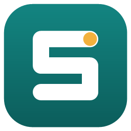
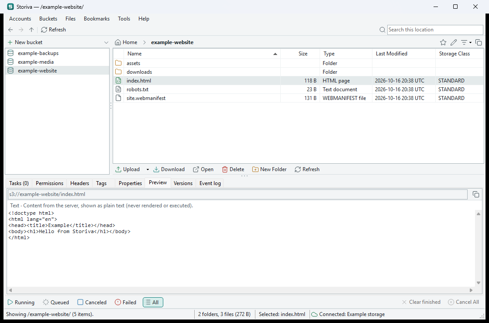
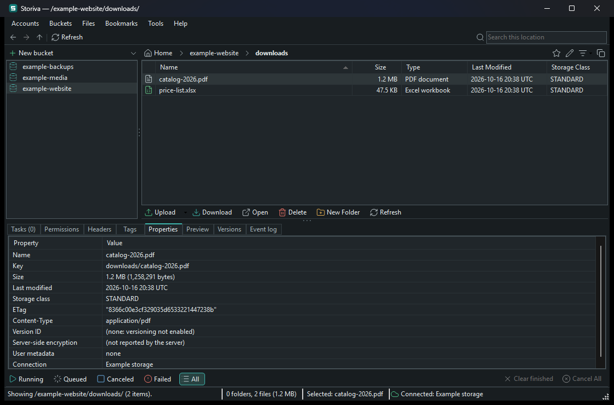
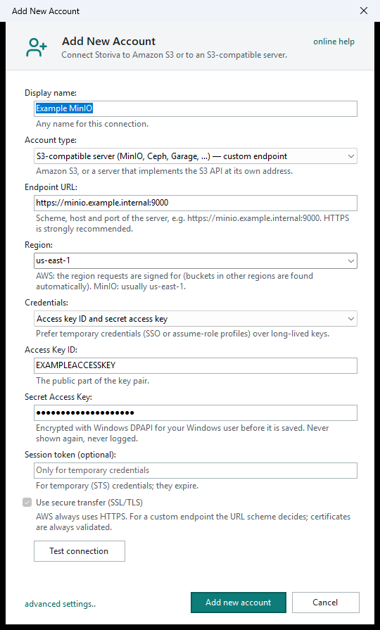
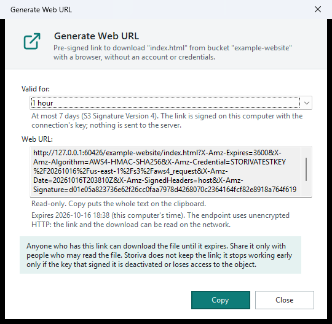
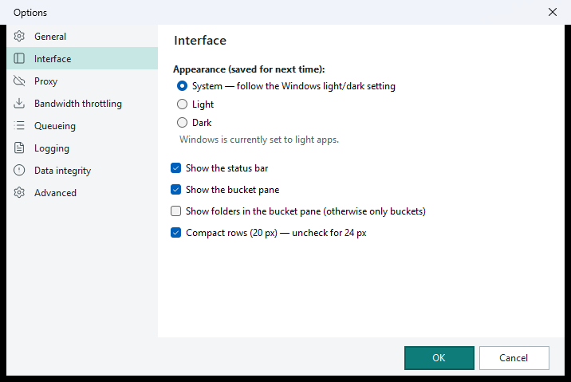
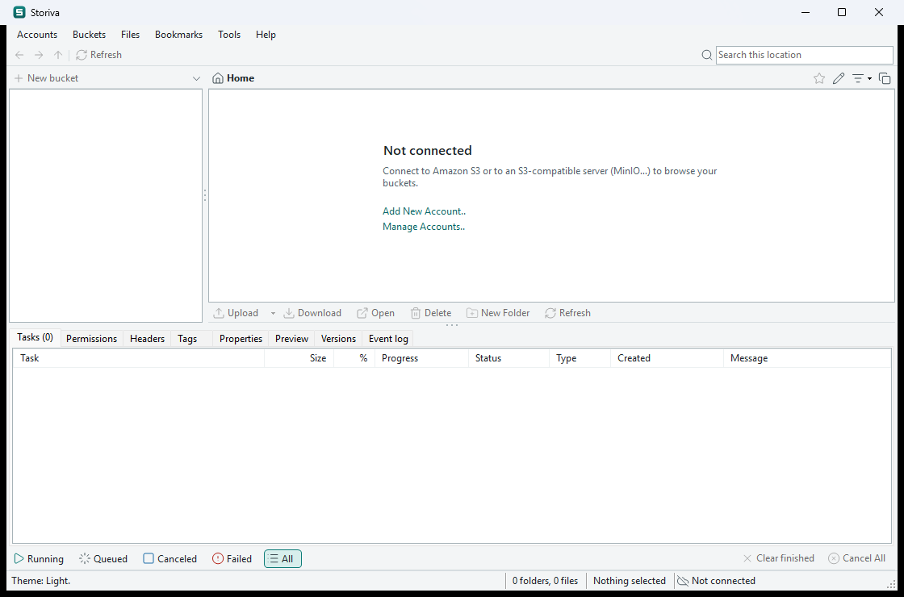

<p align="center">
  
</p>

<h1 align="center">Storiva</h1>

<p align="center">
  Cliente desktop para Windows de <b>Amazon S3</b> e de <b>armazenamento de objetos compatível com S3</b> (MinIO, Ceph, Garage e outros).<br>
  Navegue pelos buckets, envie e baixe arquivos e pastas e gerencie objetos numa interface desktop clássica e rápida.
</p>

<p align="center">
  
  
  
  <a href="https://github.com/StormLives/Storiva/actions/workflows/build.yml"></a>
</p>

<p align="center">
  <a href="README.md">Read in English</a>
</p>



<details>
<summary><b>Tema escuro</b> (Tools › Options › Interface)</summary>



</details>

> As capturas usam dados fictícios, servidos pelo servidor de teste local do projeto (`tests/Storiva.FakeS3`). Para gerá-las de novo, use `tools\capture-readme-screenshots.ps1`.

## Sumário

- [Recursos](#recursos)
- [Baixar e instalar](#baixar-e-instalar)
- [Primeiros passos](#primeiros-passos)
- [Privacidade](#privacidade)
- [Segurança](#segurança)
- [Atalhos de teclado](#atalhos-de-teclado)
- [Compilar a partir do código-fonte](#compilar-a-partir-do-código-fonte)
- [Estrutura do projeto](#estrutura-do-projeto)
- [Situação dos testes](#situação-dos-testes)
- [Política de assinatura de código](#política-de-assinatura-de-código)
- [Contribuir](#contribuir)
- [Licença](#licença)

## Recursos

### Conexões

- **Amazon S3** e qualquer **servidor compatível com S3** com endpoint próprio (MinIO, Ceph, Garage…).
- Várias conexões salvas (**Accounts › Add New Account.. / Manage Accounts..**): adicionar, editar, testar, conectar, desconectar e remover.
- Autenticação:
  - **AWS**: chave de acesso, **perfil AWS nomeado** (SSO, assume-role) ou a cadeia de credenciais padrão do AWS SDK;
  - **compatível com S3**: URL do endpoint (`https://…`, ou `http://` só com consentimento explícito), região de assinatura, endereçamento *path-style* e opções de checksum.
- **Teste de conexão** real e somente leitura, que distingue: conectado, permissões limitadas, credenciais inválidas, credenciais ausentes, acesso negado, erro de rede, erro de TLS e região/endpoint incompatível.
- O Storiva nunca se conecta sozinho: ele sempre abre desconectado e só conecta quando você clica em **Connect**.



### Navegação

- Por padrão, o painel esquerdo mostra **só os buckets**, para que um bucket com milhares de pastas não lote a árvore. As pastas abrem na lista da direita. Se quiser as pastas também na árvore: Tools › Options › Interface.
- Listagens paginadas (**Load more**), caminho em *breadcrumb*, voltar, avançar, subir e campo de caminho editável.
- Pesquisa local, filtro por tipo e ordenação em todas as colunas.
- Favoritos (*bookmarks*) de buckets e pastas.
- **Arrastar e soltar** arquivos e pastas do Explorer do Windows na lista de objetos (envia para a pasta atual) ou num bucket do painel esquerdo.
- Nomes de objeto com caracteres incomuns são preservados exatamente.

### Operações

Todas rodam na aba **Tasks**, com progresso real, cancelamento e nova tentativa:

- upload de arquivos e pastas (multipart para arquivos grandes);
- download de arquivos, pastas e buckets inteiros (em streaming para um arquivo parcial, com tratamento de nomes repetidos);
- criar pasta, excluir, copiar, recortar e colar (mover), renomear e trocar a storage class;
- criar e excluir buckets, adicionar um bucket externo pelo nome e editar o versionamento.

As transferências em andamento mostram a **velocidade e o tempo restante** ("4.2 MB/s · 12 s left"); as concluídas mostram a duração e a velocidade média. Depois de uma queda de rede, limitação de taxa ou erro do servidor, o objeto é **enviado ou baixado de novo automaticamente** (até 3 tentativas, com 2 s e 8 s de espera; nunca em erros de credencial ou permissão), e o download recomeça do zero no arquivo parcial.

Toda exclusão pede confirmação. Um bucket só pode ser excluído quando está vazio: o Storiva nunca exclui um bucket de forma recursiva.

### Compartilhamento

- **Files › Generate Web URL..** (Ctrl+W): um **link temporário** (pré-assinado) para os arquivos selecionados, válido por 15 min, 1 h, 24 h ou 7 dias. Quem tiver o link baixa o arquivo até ele expirar, sem conta. O link é calculado no seu computador pelo AWS SDK (nada é enviado ao servidor), nunca vai para o Event log nem é salvo, e o Copy pede ao Windows para não guardá-lo no histórico da área de transferência.
- **Buckets › Generate Web URLs..**: links para todos os arquivos de um bucket (até 1.000).
- Clique direito › **Copy S3 URI** (`s3://bucket/chave`) e **Copy Object URL** (o endereço HTTPS simples, que só abre para objetos públicos).



### Abas de detalhes

| Aba | O que mostra |
| --- | --- |
| Permissions | ACL do objeto ou bucket (somente leitura) |
| Headers | Resposta do HEAD e metadados `x-amz-meta-*` (somente leitura) |
| Tags | Tags do objeto, editáveis (com confirmação) |
| Properties | Tamanho, datas, storage class, ETag, tipo de conteúdo, criptografia, versão |
| Preview | Primeiros 4 KB como texto, JSON ou hexadecimal. O conteúdo nunca é renderizado nem executado |
| Versions | Versões informadas pelo servidor (somente leitura) |
| Event log | O que o Storiva fez nesta sessão, com o número de cada tarefa |

### Interface

- Temas **Claro, Escuro e Sistema**. O *Sistema* acompanha a configuração do Windows ao vivo, inclusive a barra de título e as barras de rolagem.
- Suporte a High DPI (PerMonitorV2), atalhos de teclado para os comandos principais e nomes acessíveis nos controles.
- Lembra o tamanho e a posição da janela, o tamanho dos painéis e a aba selecionada. A última conexão usada aparece primeiro no painel *Not connected*; o Storiva continua nunca se conectando sozinho.
- Ícones do [Lucide](https://lucide.dev) e ícone do aplicativo original.



## Baixar e instalar

Baixe a versão mais recente na página [Releases](https://github.com/StormLives/Storiva/releases) (Windows 10 ou 11 de 64 bits):

| Arquivo | O que é |
| --- | --- |
| `Storiva-vX.Y.Z-win-x64-setup.exe` | **Instalador (recomendado).** Instala para o seu usuário sem permissão de administrador, cria atalho no Menu Iniciar e pode ser desinstalado em Configurações › Aplicativos. Não precisa instalar mais nada. |
| `Storiva-vX.Y.Z-win-x64-portable.zip` | **Portátil.** Extraia em qualquer pasta (até num pendrive) e execute `Storiva.exe`. Não precisa instalar mais nada. |
| `Storiva-vX.Y.Z-win-x64.zip` | Versão pequena, para quem já tem o [.NET 8 Desktop Runtime](https://dotnet.microsoft.com/download/dotnet/8.0) (x64). |

O Storiva não instala serviços e não altera configurações do sistema.

> **Ainda sem assinatura digital.** O SmartScreen do Windows pode mostrar "O Windows protegeu o computador", porque o editor é desconhecido: clique em **Mais informações › Executar assim mesmo**. Os arquivos das releases são gerados apenas pelo workflow do GitHub Actions deste repositório, a partir do código da tag (veja a [Política de assinatura de código](#política-de-assinatura-de-código)). Se preferir, [compile o seu próprio Storiva.exe](#compile-o-seu-próprio-storivaexe-buildbat) a partir do código, em um passo.

### Desinstalar

- **Instalador:** Configurações › Aplicativos › Aplicativos instalados › Storiva › Desinstalar.
- **Portátil ou zip:** apague a pasta onde você extraiu.
- Nos dois casos, as conexões e configurações salvas ficam em `%LOCALAPPDATA%\Storiva`, então uma reinstalação as mantém. Para apagá-las também, apague essa pasta (ou remova cada conexão antes, em **Accounts › Manage Accounts.. › Remove**).

## Primeiros passos

1. Abra **Accounts › Add New Account..**
2. Escolha **Amazon S3 (AWS)** ou **S3-compatible server**.
3. Preencha:
   - **AWS**: região e credenciais (um perfil nomeado é preferível a chaves de longa duração);
   - **MinIO ou outro compatível com S3**: endpoint (por exemplo `https://minio.example.internal:9000`), região (`us-east-1` no MinIO) e chave de acesso. Em *advanced settings..*, deixe *path-style* ligado.
4. Clique em **Test connection**, depois em **Add new account** e em **Connect**.
5. Para desconectar: **Accounts › Disconnect from "…"**.

Sem conexão, a janela mostra o painel **Not connected**, com um link para cada conexão salva:



Mais detalhes, inclusive certificados TLS de uma CA privada: [docs/CONNECTION_SETUP.md](docs/CONNECTION_SETUP.md).

### Onde o Storiva guarda os dados

`%LOCALAPPDATA%\Storiva\`:

| Arquivo | Conteúdo |
| --- | --- |
| `settings.json` | Preferência de tema |
| `connections.json` | Conexões salvas, **sem** segredos |
| `secrets\*.bin` | Credenciais, cifradas com o DPAPI do Windows para o seu usuário |

## Privacidade

O Storiva **não tem telemetria, análise de uso, envio de relatórios de erro nem verificação de atualizações**. Ele não transfere nenhuma informação para outros sistemas em rede, a menos que você peça:

- ele se conecta apenas ao endpoint de armazenamento da conexão que você escolher, e só quando você clica em **Connect** ou **Test connection**;
- com um perfil AWS nomeado ou com a cadeia padrão do SDK, o AWS SDK também pode contatar os serviços de identidade configurados nesse perfil (por exemplo AWS SSO ou STS), ou o serviço local de metadados da instância, quando roda dentro da AWS;
- as suas credenciais ficam no seu computador, cifradas com DPAPI, e só seguem para esse endpoint na forma de assinaturas AWS Signature Version 4, calculadas pelo AWS SDK.

## Segurança

- Os certificados TLS são **sempre validados**. Não existe opção para ignorar erros de certificado; CAs privadas funcionam depois de confiadas no Windows.
- Endpoints `http://` sem criptografia exigem consentimento explícito em cada conexão e mostram um aviso.
- Os segredos ficam separados das configurações, cifrados com DPAPI, e nunca vão para logs, mensagens de erro, arquivos JSON ou linha de comando.
- Ações destrutivas pedem confirmação; buckets nunca são excluídos de forma recursiva.
- Os nomes dos arquivos baixados são higienizados: nada sai da pasta escolhida, nomes reservados do Windows (`CON`, `COM1`…) são evitados e caracteres Unicode de direção de texto, que poderiam disfarçar uma extensão (`….exe` aparecendo como `….pdf`), são substituídos.
- As requisições S3 passam apenas pelo [AWS SDK for .NET](https://github.com/aws/aws-sdk-net) oficial; o Storiva não tem assinatura de requisições escrita à mão.

Detalhes e limites: [docs/CREDENTIAL_SECURITY.md](docs/CREDENTIAL_SECURITY.md). Para relatar uma vulnerabilidade, veja [SECURITY.md](SECURITY.md).

## Atalhos de teclado

Quando o mesmo atalho existe em **Files** e em **Buckets**, o painel com o foco decide: painel de buckets → Buckets, lista de objetos → Files.

| Ação | Atalho |
| --- | --- |
| Abrir (pasta navega; arquivo mostra a aba Preview) | Enter ou duplo clique |
| Download / Upload de arquivo(s) / Upload de pasta(s) | Ctrl+D / Ctrl+U / Ctrl+Shift+U |
| Recortar / Copiar / Colar | Ctrl+X / Ctrl+C / Ctrl+V |
| Renomear / Excluir | F2 / Del (no painel de buckets: Delete Bucket) |
| Nova pasta (lista) · Novo bucket (painel de buckets) | Ctrl+N |
| Atualizar | F5 |
| Abas Permissions / Headers / Tags / Properties | Ctrl+L / Ctrl+H / Ctrl+T / Ctrl+P |
| Selecionar tudo / Inverter seleção | Ctrl+A / Ctrl+I |
| Add External Bucket / Edit Versioning | Ctrl+E / Ctrl+Shift+V |
| Options | Alt+O |
| Voltar / Avançar / Subir | Alt+← / Alt+→ / Alt+↑ (Backspace na lista sobe um nível) |
| Generate Web URL (link temporário) | Ctrl+W |
| Pesquisar / limpar · Editar o caminho · Ajuda | Ctrl+F / Esc · Alt+D · F1 |

## Compile o seu próprio Storiva.exe (build.bat)

Qualquer pessoa pode gerar o mesmo `Storiva.exe` portátil a partir do código, sem Visual Studio:

1. Instale o **[.NET 8 SDK](https://dotnet.microsoft.com/download/dotnet/8.0)** (8.0.426 ou mais novo, x64).
2. Baixe o código: **Code › Download ZIP** no GitHub (ou `git clone https://github.com/StormLives/Storiva.git`) e extraia.
3. Dê dois cliques em **`build.bat`** (ou rode `build.bat test` num terminal para rodar os testes antes).
4. O executável fica em **`dist\Storiva.exe`**: um arquivo só, que roda sem instalar mais nada.

Um arquivo compilado por você não vem da internet, então o SmartScreen não mostra o aviso de editor desconhecido para ele.

## Compilar a partir do código-fonte

Requisitos: Windows 10 ou 11 (x64) e o **.NET 8 SDK** 8.0.426 ou mais novo na faixa 8.0 (veja `global.json`).

```powershell
git clone https://github.com/StormLives/Storiva.git
cd Storiva

dotnet restore Storiva.sln
dotnet build Storiva.sln -c Release
dotnet test Storiva.sln -c Release
dotnet run --project src\Storiva.App -c Release

# Pasta com o Storiva.exe (depende do .NET 8 Desktop Runtime para rodar)
dotnet publish src\Storiva.App -c Release -o artifacts\release

# Storiva.exe portátil, arquivo único com o .NET dentro (o que o build.bat faz)
dotnet publish src\Storiva.App -c Release -p:PublishProfile=win-x64-portable -p:DebugType=none -o dist
```

O instalador é gerado com o [Inno Setup 6](https://jrsoftware.org/isinfo.php), a partir de `installer\Storiva.iss`, pelo workflow de release.

Validação completa (recompila Debug e Release do zero, roda todos os testes, publica e executa o smoke test da interface contra um servidor S3 falso em 127.0.0.1):

```powershell
powershell -NoProfile -ExecutionPolicy Bypass -File tools\validate.ps1
```

O log fica em `artifacts\validation-log.txt`, e as capturas do smoke test, em `artifacts\smoke-release\`.

## Estrutura do projeto

```
Storiva.sln
src/
  Storiva.Core/            Modelos, navegação, comandos, detalhes, fila de tarefas, conexões e os contratos do
                           cliente de armazenamento. Sem interface e sem código de rede.
  Storiva.Infrastructure/  S3/ (cliente do AWS SDK, fábrica, mapeamento de erros), Persistence/ (JSON), Security/ (DPAPI)
  Storiva.App/             Interface Windows Forms: janela principal, diálogos, abas de detalhes, temas, ícones
    Assets/                Ícones Lucide (com LICENSE e lista SHA-256), ícone do app, textos das licenças de terceiros
tests/
  Storiva.Tests/           Testes xUnit (sem chamadas externas)
  Storiva.FakeS3/          Servidor S3 falso em 127.0.0.1 para os testes, o smoke test e as capturas (não é distribuído)
tools/                     validate.ps1, capture-readme-screenshots.ps1, capture-window.ps1, generate-brand-icon.ps1
installer/                 Script do Inno Setup para o instalador do Windows
build.bat                  Gera o dist\Storiva.exe portátil em um passo
docs/                      Configuração de conexões, segurança das credenciais, temas, testes, arquitetura, licenças
.github/workflows/         CI: build, testes e publicação; release em rascunho com instalador, portátil e zip nas tags de versão
```

Para outro provedor de armazenamento, implemente `Storiva.Core.Remote.IObjectStorageClient` e a sua fábrica, e registre-os em `Program.CreateMainForm`.

## Situação dos testes

- **459 testes unitários** (457 executados; 2 testes de integração opcionais com MinIO/AWS ficam ignorados até serem configurados). Rodam a cada push no GitHub Actions e nunca chamam serviços externos.
- O AWS SDK real é exercitado contra o **servidor S3 falso do projeto, em 127.0.0.1**, inclusive TLS com certificado não confiável. O servidor falso confere o ID da chave, mas não valida as assinaturas.
- Um **smoke test da interface**, com 149 verificações, opera a janela real: layout, menus, diálogos, temas e, contra o servidor falso, conectar, listar, enviar, arrastar e soltar, baixar, copiar, excluir, tags, links temporários, janela lembrada e desconectar.
- Contra um **MinIO real**, até agora rodou apenas o teste de conexão, que é somente leitura (resultado: conectado). As operações de escrita ainda não foram verificadas num MinIO real nem na AWS. Para rodar os testes de integração no seu ambiente de teste, veja [docs/TESTING.md](docs/TESTING.md).

## Documentação

- [docs/CONNECTION_SETUP.md](docs/CONNECTION_SETUP.md): conexão com AWS e MinIO, TLS com CA privada.
- [docs/CREDENTIAL_SECURITY.md](docs/CREDENTIAL_SECURITY.md): como as credenciais são guardadas e o que o DPAPI protege e não protege.
- [docs/THEMES.md](docs/THEMES.md): temas claro, escuro e sistema, e os seus limites.
- [docs/TESTING.md](docs/TESTING.md): suítes de teste, smoke test e testes de integração.
- [docs/REAL_S3_IMPLEMENTATION.md](docs/REAL_S3_IMPLEMENTATION.md): arquitetura, decisões de projeto e riscos conhecidos.
- [docs/ASSET_LICENSES.md](docs/ASSET_LICENSES.md) e [THIRD_PARTY_NOTICES.md](THIRD_PARTY_NOTICES.md): origem e licença de cada recurso e biblioteca incluídos.

## Política de assinatura de código

<!-- Depois que a SignPath Foundation aprovar o projeto, acrescente aqui e na página da release:
Free code signing provided by [SignPath.io](https://about.signpath.io), certificate by [SignPath Foundation](https://signpath.org).
-->

As versões para Windows do Storiva devem ser assinadas pelo programa de código aberto da [SignPath Foundation](https://signpath.org). Até o projeto ser aceito, os executáveis publicados **não são assinados**.

- Só são publicados ou assinados os executáveis gerados pelo [workflow do GitHub Actions](.github/workflows/build.yml) deste repositório, a partir de um commit com tag. Nada compilado numa máquina pessoal é publicado.
- Cada pedido de assinatura é aprovado manualmente por um aprovador.
- Todos os membros da equipe usam autenticação de dois fatores no GitHub (e na SignPath).

Papéis na equipe:

| Papel | Membros |
| --- | --- |
| Committers e revisores | [@StormLives](https://github.com/StormLives) |
| Aprovadores | [@StormLives](https://github.com/StormLives) |

Privacidade: veja [Privacidade](#privacidade). O Storiva não transfere nenhuma informação para outros sistemas em rede, a menos que o usuário peça.

## Contribuir

Issues e pull requests são bem-vindos; leia antes o [CONTRIBUTING.md](CONTRIBUTING.md).

## Licença

O Storiva é distribuído sob a [Licença MIT](LICENSE).

Os componentes de terceiros mantêm as suas licenças: ícones [Lucide](https://lucide.dev) (ISC; os derivados do Feather também MIT), [AWS SDK for .NET](https://github.com/aws/aws-sdk-net) (Apache-2.0) e `System.Security.Cryptography.ProtectedData` (MIT). Os textos completos estão em [THIRD_PARTY_NOTICES.md](THIRD_PARTY_NOTICES.md) e também acompanham o `Storiva.exe`.

Amazon S3 e AWS são marcas da Amazon.com, Inc. ou de suas afiliadas; MinIO é marca da MinIO, Inc. O Storiva é um projeto independente, sem afiliação nem endosso dessas empresas.
